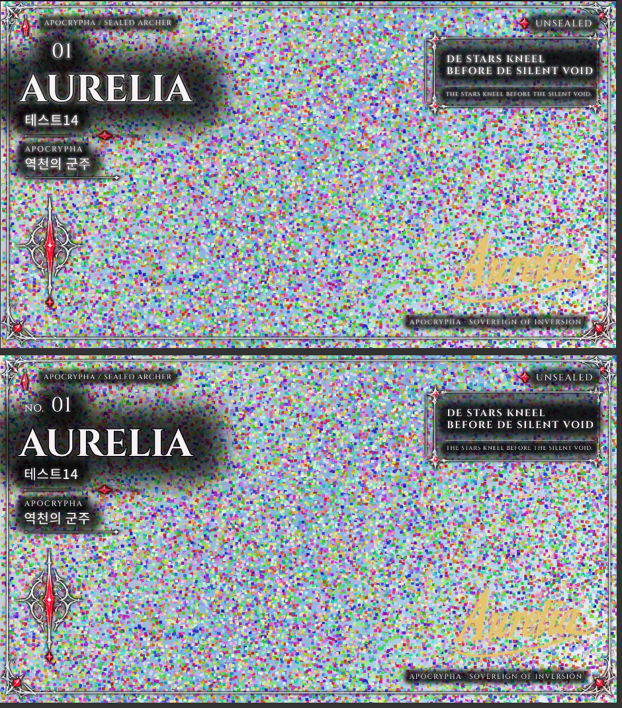

# Frame Studio 12 평가 및 개선 방안

- 대상: `Frame_Studio_12.html` (2,928줄, 2.1MB. 그중 약 1.9MB가 base64 프레임 에셋 40개와 서명용 글꼴 6종)
- 방법: [마스터 프롬프트](01-master-prompt.md)의 6단계를 그대로 수행. 코드 전체 정독 → 웹 조사 → 헤드리스 Chromium 실측(`tools/verify-frame-studio.js`) → 평가 → 개선안
- 줄 번호는 원본 HTML 기준입니다.
- **적용 현황:** 5-1 "지금" 단계 10건은 `frame-studio/Frame_Studio_13.html`에 반영했습니다. 내역과 검증 결과는 [03-changes-v13.md](03-changes-v13.md)에 있습니다.
- **적용 현황:** 5-2 "다음" 단계 8건은 `frame-studio/Frame_Studio_14.html`에 반영했습니다(Safari 항목은 완화책만). 내역은 [04-changes-v14.md](04-changes-v14.md)에 있습니다.

## 1. 총평

설계의 뼈대는 탄탄합니다. 템플릿을 검증된 JSON 스키마로 다루고, AI는 값 범위가 제한된 파라미터만 건드리게 했으며, 글꼴 윤곽을 직접 읽어 서명을 그리는 엔진까지 외부 라이브러리 없이 구현했습니다. 초기 로드에서 콘솔 오류는 없었고 1670×941 PNG 내보내기는 0.6초에 끝났습니다.

약점은 세 군데에 몰려 있습니다. 먼저 고칠 것은 다음 셋입니다.

1. **미리보기와 내보낸 결과가 다릅니다.** 가독성 뒤판을 켜면 미리보기에서는 고정 글자 "NO."가 뒤판에 가려지는데 내보낸 PNG에는 보입니다(실측, 아래 그림).
2. **Claude 아티팩트 밖에서는 ZIP·프로젝트·프리셋 파일을 저장할 수 없습니다.** 저장 창이 없으면 무엇이든 ``에 넣어 보여 주는데, ZIP과 JSON은 이미지가 아니라서 깨진 그림만 나옵니다(실측).
3. **작은 오동작이 여러 개 쌓여 있습니다.** 내보내기 형식·범위 버튼의 선택 표시가 처음부터 꺼져 있고, "조금 더 굵게"라고 쓰면 서명이 금색으로 바뀌며, 템플릿을 바꾸면 입력한 이름이 기본값으로 돌아갑니다(모두 실측). 각각 몇 줄이면 고칩니다.



## 2. 관점별 점수 (5점 만점)

| # | 관점 | 점수 | 근거 |
|---|---|---|---|
| 1 | 핵심 워크플로 | 4 | 입력 → 서명 → 이미지 → 내보내기, CSV 일괄 생성, 프리셋, 프로젝트 저장까지 한 흐름으로 이어짐 |
| 2 | 사용성 | 3 | 실행 취소·스냅·상태 메시지는 좋음. 탭 10개, 개발자용 탭 노출, 템플릿 간 값 미공유 |
| 3 | 결과물 품질 | 3.5 | 9분할 프레임, 자동 폭 맞춤, 색 물들이기 필터가 깔끔. 자동 줄바꿈과 커닝이 없음 |
| 4 | 접근성 | 2.5 | aria-live, 라벨, 포커스 링은 있음. 탭 키보드 패턴, 작은 타깃, 낮은 대비 글자 |
| 5 | 성능 | 3 | 이미지 없을 때 다시 그리기 6.8ms. 3000px 이미지를 넣으면 27ms, 매번 3.4MB 문자열 재파싱 |
| 6 | 안정성·데이터 보존 | 2.5 | 저장 실패를 조용히 무시, 이미지 삭제는 되돌릴 수 없음, 사용자 템플릿 삭제 불가 |
| 7 | 내보내기·호환성 | 2.5 | PNG/JPG/WebP/SVG와 투명 내보내기는 좋음. 호스트 밖 저장 불가, SVG 글꼴 미포함, 크기 한계 무방비 |
| 8 | 확장성 | 2 | 프레임 에셋이 파일에 고정. 사용자 프레임 추가 불가, 고정 장식은 JSON으로만 편집 |
| 9 | 모바일 | 3 | 미리보기 고정, 핀치 확대, 터치 크기 보정. 도구 막대는 고정되지 않고 FAB가 입력칸을 가림 |
| 10 | AI 연동 | 3.5 | 출력 검증과 폴백 구조가 모범적. 폴백 키워드 규칙에 오탐 |
| 11 | 보안·프라이버시 | 4 | 모든 삽입값을 이스케이프·화이트리스트 처리, 이미지는 기기 안에만 보관. 구글 폰트 외부 요청만 있음 |
| 12 | 코드 구조 | 2.5 | 한 IIFE에 2,400줄, `paint()` 하나가 렌더·저장·이력·UI 동기화를 모두 수행, 테스트 없음 |

## 3. 잘된 점 (고칠 때 지켜야 할 것)

- **템플릿 검증(1251–1287줄).** 색은 정규식, 글꼴·정렬·에셋은 화이트리스트로 걸러서 JSON 탭에 무엇을 붙여 넣어도 마크업이 주입되지 않습니다.
- **AI 출력 처리(1702–1712줄).** Claude의 응답을 그대로 쓰지 않고 파라미터별 범위로 자른 뒤 적용합니다. 캐릭터 정보에 이상한 지시문이 섞여도 결과가 깨지지 않는 구조입니다.
- **내보내기 글자 처리(2129–2227줄).** SVG를 이미지로 바꿀 때 웹폰트가 빠지는 문제를, 장식만 SVG로 그리고 글자는 캔버스에 따로 얹는 방식으로 피했습니다. 웹 조사에서 확인된 대표적 함정을 정확히 우회한 설계입니다.
- **서명 엔진(855–1244줄).** TrueType/WOFF 파서, 한글 음절이 없을 때 자모로 풀어 그리는 폴백, 이름+변형 번호로 결정되는 시드.
- **대비 검사와 자동 보정(1895–1948줄).** 실제 배경 픽셀을 읽어 항목별 대비를 계산합니다. 밝은 잡음 이미지에서 1.3:1이던 항목들이 자동 보정 뒤 4.5:1 안팎으로 올라갔습니다(실측).
- **모바일 대응 흔적.** 안드로이드 갤러리의 파일 입력 문제 우회(2062–2064줄), HEIC 안내, 웹뷰 안내 문구.

## 4. 이슈 목록

검증 상태: **실측** = 브라우저에서 재현, **코드** = 코드로 확인, **추정** = 조사에 따른 위험.
심각도: 4 치명, 3 중대, 2 경미, 1 외관.

| ID | 관점 | 현상 | 근거 | 검증 | 심각도 |
|---|---|---|---|---|---|
| B1 | 내보내기 | 호스트의 저장 기능이 없으면 ZIP·프로젝트 JSON·프리셋 파일도 ``로 표시해 저장할 방법이 없음. 일괄 생성 결과를 통째로 잃음 | 2262–2267줄. JSON 저장 시 `img.decode()` 실패 확인 | 실측 | 4 |
| B2 | 품질 | 가독성 뒤판이 슬롯 레이어 맨 아래에 들어가 고정 레이어의 글자("NO.")를 덮음. 내보내기에서는 글자를 나중에 그려 보임 → 미리보기와 결과 불일치 | 1467줄, 552줄 | 실측 | 3 |
| B3 | 사용성 | `applyView()`가 문서의 모든 `.seg button`에 `aria-pressed`를 다시 써서 내보내기 범위·형식, 이미지 채우기 방식의 선택 표시가 꺼짐 | 1488줄. 로드 직후 `#expFmt` 4개 모두 false | 실측 | 3 |
| B4 | 워크플로 | 템플릿을 바꾸면 같은 key(nameEn, nameKo 등)의 입력값이 따라오지 않고 기본값 CELESTIS로 돌아감 | 1295줄. AURELIA 입력 후 간결형으로 전환 시 CELESTIS | 실측 | 3 |
| B5 | AI | 키워드 폴백에서 `/금|gold/`가 "조금"에 걸림. "조금 더 굵게" → 색이 금색으로 바뀜 | 1125줄. 결과 `weight → 0.6 · color → #e8c36a` | 실측 | 3 |
| B6 | 내보내기 | 캔버스 크기 한계 검사가 없음. 6000×6000 템플릿을 3배로 내보내면 "내보내지 못했습니다: blob"만 표시 | 1257줄, 2212–2225줄 | 실측 | 3 |
| B7 | 안정성 | 이미지 제거가 확인 없이 IndexedDB에서도 지우고, 실행 취소 대상이 아님 | 2044줄, 2624–2627줄 | 코드 | 3 |
| B8 | 안정성 | 사용자 템플릿을 지우는 방법이 없음. JSON 적용으로 생긴 템플릿이 목록에 계속 남음 | 1823줄. 삭제 코드 없음 | 실측 | 2 |
| B9 | 안정성 | CSV 일괄 생성은 한 줄이 실패하면 전체가 중단됨(여러 이미지 일괄은 건너뜀). "50명만 처리" 안내는 곧바로 진행 메시지에 덮임 | 2375–2389줄 대 2420–2428줄 | 코드 | 2 |
| B10 | AI | 한글 입력 중 Enter가 조합 확정과 동시에 요청을 보냄(`isComposing` 미확인) | 1800줄 | 코드 | 2 |
| B11 | 성능 | 이미지를 data URL로 SVG에 넣어 입력·드래그마다 3.4MB 문자열을 다시 파싱. 다시 그리기 6.8ms → 27ms | 704줄, 1526줄 | 실측 | 2 |
| B12 | 성능 | 3배 PNG 한 장이 27MB. 60장을 메모리에 모아 ZIP으로 묶으면 1.6GB 수준이라 모바일에서 탭이 죽을 수 있음 | 2427줄, 실측 27,007KB | 추정 | 3 |
| B13 | 접근성 | 탭 10개가 모두 Tab 순서에 있고 방향키 이동이 없음 | 245–256줄, 1608줄. `tabIndex` 전부 0 | 실측 | 2 |
| B14 | 접근성 | 보조 글자 대비 부족: key 표기 3.4:1(10.5px), AI 안내문 4.1:1(11.5px). 입력칸 테두리 1.2~1.3:1 | 97줄, 113줄, 14줄 | 실측(계산) | 2 |
| B15 | 접근성 | 데스크톱에서 항목별 색 칸 26×20px, 크기 입력 52×23px로 24×24 기준 미달 | 164–165줄 | 실측 | 2 |
| B16 | 접근성 | "캐릭터 이미지 불러오기"가 `<label>`이라 키보드 초점이 보이지 않는 숨은 파일 입력으로 감 | 236–237줄 | 코드 | 2 |
| B17 | 품질 | 자동 줄바꿈이 없음. 긴 문장은 55%까지 줄인 뒤 글자를 눌러서 맞춤 | 1470–1481줄 | 코드 | 3 |
| B18 | 품질 | 대비 검사가 "큰 글자"를 캔버스 좌표 24px로 판정. 1670px 카드를 폰에서 보면 24px 글자는 약 6px. 서명은 검사·보정 대상이 아님(밝은 배경에서 금색 서명이 묻힘) | 1911줄 | 실측 | 2 |
| B19 | 내보내기 | SVG는 구글 폰트를 `@import`로만 참조. 이미지로 넣거나 편집기에서 열면 글꼴이 바뀜. 모노 글꼴은 목록에서도 빠짐 | 2228줄, 2242줄 | 코드 | 2 |
| B20 | 내보내기 | 오프라인이거나 글꼴 로드에 실패하면 대체 글꼴로 조용히 내보냄 | 2211줄 (`catch(() => null)`) | 코드 | 2 |
| B21 | 안정성 | localStorage 저장 실패를 무시(1318줄). `storage.persist()` 요청 없음. Safari는 7일간 방문이 없으면 저장소를 지울 수 있음 | 1318줄 | 추정 | 2 |
| B22 | 호환성 | 프레임 PNG를 SVG 안에 넣은 뒤 그 SVG를 캔버스에 그림. Safari에서 SVG 속 이미지가 첫 시도에 빠지는 사례가 보고됨 | 2187줄, 2221줄 | 추정 | 3 |
| B23 | 사용성 | 서명 설정은 모든 템플릿 공용, 장식색·가독성·테두리 막은 템플릿별. 안내문은 "템플릿마다 따로 기억"이라고만 함 | 1291줄 | 코드 | 1 |
| B24 | 모바일 | 좁은 화면에서 도구 막대가 미리보기와 패널 사이에 3줄로 놓이고, 실행 취소 FAB가 글꼴 선택 칸을 가림 | 187줄, 181줄 | 실측 | 2 |
| B25 | 사용성 | "진행 단계"(개발 로드맵)와 "템플릿 JSON" 탭이 일반 편집 탭과 같은 줄에 있음 | 254–255줄 | 코드 | 1 |
| B26 | 코드 | CSS 규칙 중복·충돌(`.chip[aria-pressed]`가 147줄과 173줄에서 다른 색), `typeof syncDecoUI === 'function'` 같은 선언 순서 의존, 숫자 검증은 하되 변환은 안 함(문자열 "5"가 `+ 80`에서 이어 붙음) | 147/173줄, 1528–1530줄, 1267줄 | 코드 | 1 |
| B27 | 서명 | CFF(.otf)·WOFF2 미지원, 커닝·합자 미적용이라 이어 쓰는 필기체의 연결이 어긋날 수 있음. 전부 대문자로 쓴 이름은 강제로 첫 글자만 대문자가 됨 | 907–916줄, 1142줄 | 코드 | 2 |

테스트하지 못한 것: iOS Safari와 실제 안드로이드 기기(환경에 Chromium만 있음), Claude 아티팩트 안에서의 `claude.use('sample' / 'downloads')` 동작, 구글 폰트 23종 중 20종(테스트 환경에서 Cinzel, IBM Plex Mono, Noto Sans KR만 로드됨).

## 5. 개선안

점수 = Impact × Confidence ÷ Effort(작업일). 사용량 데이터가 없어 Reach는 생략했습니다. 1인 도구이므로 Impact는 "카드 한 세트를 만드는 흐름이 얼마나 나아지는가"로 매겼습니다.

### 5-1. 지금 (각 반나절 이내)

| 순위 | 개선 | 해결 | I | C | E | 점수 |
|---|---|---|---|---|---|---|
| 1 | `applyView()` 선택자를 `.bar .seg button[data-view]`로 한정 | B3 | 2 | 100% | 0.1 | 20 |
| 2 | 금색 키워드를 `금색|금빛|황금|gold`로 좁히고 "조금"류를 먼저 제거 | B5 | 1 | 100% | 0.1 | 10 |
| 3 | Enter 처리에 `!e.isComposing && e.keyCode !== 229` 추가 | B10 | 1 | 100% | 0.1 | 10 |
| 4 | 저장 폴백: 이미지가 아니면 `<a download>` + blob URL을 먼저 시도하고, 그것도 막히면 텍스트는 복사 상자로 | B1 | 3 | 80% | 0.5 | 4.8 |
| 5 | 뒤판을 슬롯 레이어가 아닌 `#L-fixed` 앞(이미지 바로 위)에 넣거나, 고정 글자도 뒤판 계산에 포함 | B2 | 2 | 100% | 0.5 | 4 |
| 6 | 내보내기 전 `w×h×배율²` 검사: 1,600만 픽셀 초과 시 가능한 최대 배율을 안내 | B6 | 2 | 80% | 0.5 | 3.2 |
| 7 | 템플릿 전환 시 같은 key의 값을 이어받기 | B4 | 2 | 100% | 0.5 | 4 |
| 8 | 이미지 제거를 "한 번 더 누르면 삭제"로(프리셋 삭제와 같은 방식) | B7 | 1 | 100% | 0.2 | 5 |
| 9 | 대비 미달 색 3개 교체(`#6f6672`→`#9a909b` 등), 색 칸·크기 입력 최소 24px | B14, B15 | 1 | 100% | 0.3 | 3.3 |
| 10 | CSV 일괄에 줄 단위 try/catch와 건너뛴 줄 보고 | B9 | 1 | 100% | 0.3 | 3.3 |

### 5-2. 다음 (1~2주)

| 개선 | 내용 | 해결 | I | C | E | 점수 |
|---|---|---|---|---|---|---|
| 캐릭터 목록 | 값·이미지·서명 설정을 캐릭터 단위로 저장하고 목록에서 전환. 이미지 저장소를 `current` 한 칸에서 캐릭터 id별로 확장. 로드맵 P6에 "예정"으로 적힌 항목 | B4, B23 | 3 | 80% | 3 | 0.8 |
| 자동 줄바꿈 | 슬롯에 `wrap: true`, `maxLines` 추가. 한글은 어절, 영문은 단어 단위로 `measureText`로 끊고 넘치면 그때 축소 | B17 | 3 | 80% | 2 | 1.2 |
| 렌더 분리 | 이미지 레이어를 SVG 밖의 ``/캔버스로 빼고 CSS transform으로 이동. 에셋 `<defs>`는 한 번만 넣고 슬롯 레이어만 교체. 입력은 `requestAnimationFrame`으로 묶기 | B11 | 2 | 80% | 2 | 0.8 |
| 일괄 생성 메모리 | 예상 용량을 미리 계산해 경고, 20장 단위로 ZIP 분할, 진행 중 취소 버튼 | B12 | 2 | 80% | 1 | 1.6 |
| 탭 정리 | APG 탭 패턴 적용(roving tabindex, 방향키, Home/End). "템플릿 JSON"과 "진행 단계"는 "고급" 아래로 | B13, B25 | 1 | 100% | 1 | 1 |
| 저장 신뢰성 | 저장 실패 시 상태 표시, 첫 저장 때 `navigator.storage.persist()` 요청, "마지막 저장 시각" 표시, 사용자 템플릿 삭제·복제 버튼 | B8, B21 | 2 | 80% | 1.5 | 1.1 |
| 모바일 도구 막대 | 보기 전환·편집 토글을 미리보기 아래 한 줄 가로 스크롤로, FAB는 미리보기 모서리로 이동 | B24 | 1 | 80% | 1 | 0.8 |
| 프레임 직접 그리기 | 내보내기에서 9분할 조각을 `drawImage`로 캔버스에 직접 그려 SVG 속 이미지 의존을 제거. 색 물들이기만 SVG 필터 유지 | B22 | 2 | 50% | 2 | 0.5 |

### 5-3. 나중 (도구의 범위를 넓히는 것)

- **사용자 프레임 에셋.** PNG를 올리고 9분할 여백 4개를 지정하면 `frame9`/`slice9`에서 쓸 수 있게. 지금은 한 가지 화풍에 묶여 있어 확장성 점수가 가장 낮습니다. `ASSETS` 화이트리스트 구조는 유지하고 사용자 에셋을 IndexedDB에서 읽어 같은 표에 등록하면 검증 로직을 바꾸지 않아도 됩니다.
- **고정 장식 드래그 편집.** 로드맵 P2에 남은 항목. 슬롯 편집 코드(`slotBox`, `snapDelta`)를 고정 요소에도 쓰도록 일반화.
- **이미지에서 테마 추출.** 불러온 이미지의 주조색을 뽑아 장식색·서명색·테두리 막을 한 번에 제안. 대비 검사에 이미 픽셀을 읽는 코드가 있어 재사용할 수 있습니다.
- **글자를 윤곽으로 바꾼 SVG.** 서명 엔진의 파서로 본문 글자도 path로 내보내면 글꼴 없이 어디서나 같게 보입니다. 구글 폰트 파일을 직접 받아야 하고 CFF 글꼴은 지금 파서로 읽지 못하므로 대상 글꼴을 TrueType으로 한정해야 합니다.
- **인쇄용 출력.** 경쟁 도구 Dextrous는 블리드·재단선·CMYK PDF·글꼴 임베드를 내세웁니다. 실물 카드로 뽑을 계획이 있을 때만 의미가 있고, 화면용이라면 "가로 픽셀 직접 지정"과 안전 영역 가이드 정도로 충분합니다.
- **구글 시트 연결.** Dextrous와 nanDECK의 핵심은 스프레드시트 한 줄 = 카드 한 장입니다. 지금의 CSV 붙여넣기에 공개 시트 CSV 주소 불러오기를 더하면 같은 흐름이 됩니다.
- **코드 분리와 테스트.** `validate`, `parseTable`, `parseBulk`, `interpretStyle`, `fileBase`, `makeZip`은 DOM 없이 돌아가는 순수 함수라 바로 단위 테스트를 붙일 수 있습니다(B5 같은 오탐은 테스트 한 줄로 잡힙니다). 서명용 한글 글꼴 2종(base64 약 845KB)은 서명 탭을 열거나 한글 서명을 쓸 때 읽어도 됩니다.

## 6. 상위 5개 구현 스케치

**① B3 선택 표시 (1488줄)**
```js
$$('.bar .seg button[data-view]').forEach(b => b.setAttribute('aria-pressed', b.dataset.view === state.view));
```

**② B1 저장 폴백 (2266줄 `saveBlob`)**
```js
function anchorSave(blob, filename) {
  const url = URL.createObjectURL(blob), a = document.createElement('a');
  a.href = url; a.download = filename; document.body.append(a); a.click(); a.remove();
  setTimeout(() => URL.revokeObjectURL(url), 10000);
}
// downloadsCap이 없을 때: 이미지면 지금처럼 표시하고 추가로 anchorSave 시도,
// 이미지가 아니면 anchorSave만. 샌드박스가 막아 실패해도 예외가 나지 않으므로
// "저장이 시작되지 않으면 …" 안내문을 함께 띄운다.
```
주의: 아티팩트 샌드박스에서는 앵커 다운로드가 막혀 있을 수 있어 `downloadsCap`이 있을 때의 경로는 그대로 둡니다.

**③ B2 뒤판 위치 (1444줄 `applyLegibility`)**
뒤판을 `#L-slots`가 아니라 새 그룹 `<g id="L-back">`에 모아 `#L-fixed`의 이미지·스크림 바로 뒤에 넣습니다. 테두리 막을 넣는 위치 계산(1433줄)과 같은 자리입니다. 이렇게 하면 프레임·고정 글자가 뒤판 위에 그려져 미리보기와 내보내기가 같아집니다. 내보내기 경로는 `fit(host)`가 같은 함수를 부르므로 따로 고칠 것이 없습니다.

**④ B4 값 이어받기 (1847줄 템플릿 변경 핸들러)**
```js
const prev = valsOf(), prevDef = defaultsOf(cur());
state.tplId = e.target.value;
const next = valsOf(), nextDef = defaultsOf(cur());
Object.keys(next).forEach(k => {                    // 사용자가 바꾼 값만, 대상이 아직 기본값일 때만
  if (k in prev && prev[k] !== prevDef[k] && next[k] === nextDef[k]) next[k] = prev[k];
});
```
캐릭터 목록(5-2)을 만들면 값의 주인이 템플릿에서 캐릭터로 바뀌므로 이 코드는 그때 사라집니다.

**⑤ B6 크기 검사 (2196줄 `renderRaster` 앞부분)**
```js
const MAX_AREA = 16_000_000;                        // iOS Safari의 보수적 한계
if (box.w * box.h > MAX_AREA) {
  const s = Math.floor(Math.sqrt(MAX_AREA / (tpl.canvas.w * tpl.canvas.h)) * 10) / 10;
  throw new Error(`이 크기(${box.w}×${box.h})는 브라우저가 만들 수 없습니다. 배율을 ${s}배 이하로 낮추세요.`);
}
```
`refreshExportUI()`의 크기 표시(2259줄)에도 같은 조건으로 경고를 붙이면 누르기 전에 알 수 있습니다.

## 7. 실측 결과 원본

| 항목 | 값 |
|---|---|
| 초기 로드 | 약 1.1초, 콘솔 오류 0건 |
| 다시 그리기(이미지 없음) | 중앙값 6.8ms, 캔버스 HTML 464KB |
| 다시 그리기(3000×2000 JPG 2.2MB) | 중앙값 27ms, 캔버스 HTML 3,480KB |
| PNG 1배 내보내기 | 0.63초, 1670×941, 4.0MB |
| PNG 3배 내보내기 | 1.42초, 5010×2823, 27.0MB |
| 6000×6000 템플릿 3배 | 실패, 메시지 "내보내지 못했습니다: blob" |
| 대비 검사(밝은 잡음 이미지) | 보정 전 10개 중 9개 미달(1.2~1.3:1) → 자동 보정 후 1개 미달(4.2:1) |
| 390px 화면 | 가로 넘침 없음 |
| localStorage 사용량 | 4KB |

데스크톱 Chromium(헤드리스) 한 대에서 잰 값이라 휴대폰에서는 몇 배 느릴 수 있습니다.

## 8. 출처

- Anthropic, Best practices for prompt engineering — https://claude.com/blog/best-practices-for-prompt-engineering
- Heuristic evaluation template — https://cleverx.com/blog/heuristic-evaluation-template/
- W3C, What's New in WCAG 2.2 — https://www.w3.org/WAI/standards-guidelines/wcag/new-in-22/
- W3C, Understanding SC 1.4.3 — https://w3c.github.io/wcag/understanding/contrast-minimum
- W3C WAI-ARIA APG, Tabs Pattern — https://www.w3.org/WAI/ARIA/apg/patterns/tabpanel/
- web.dev, Storage for the web — https://web.dev/articles/storage-for-the-web
- Apple Developer Forums, Safari 저장소 7일 정책 — https://developer.apple.com/forums/thread/710157
- How SVG to PNG conversion actually works in the browser — https://dev.to/usman_basheers/how-svg-to-png-conversion-actually-works-in-the-browser-5307
- 웹폰트와 SVG 변환 — https://dev.to/x_kernel27795/katex-html-to-image-outputs-a-blank-white-image-heres-why-and-how-to-fix-it-2ikd
- WebKit Bugzilla 230886 — https://www2.webkit.org/show_bug.cgi?id=230886
- Safari에서 SVG 속 이미지 누락 — https://kiwix.lema.org/stackoverflow.com_en_all_2023-11/questions/69949555/convert-svg-with-image-not-working-in-safari
- Dextrous 소개(개발자 본인 글) — https://www.bgdf.com/forum/general/announcements-press-releases/dextrous-prototyping-platform
- AlternativeTo, Dextrous — https://alternativeto.net/software/dextrous/about
- AlternativeTo, nanDECK — https://alternativeto.net/software/nandeck
- Game card making software 비교 — https://worldmetrics.org/best/game-card-making-software/
- ProductPlan, RICE Scoring Model — https://productplan.com/glossary/rice-scoring-model
