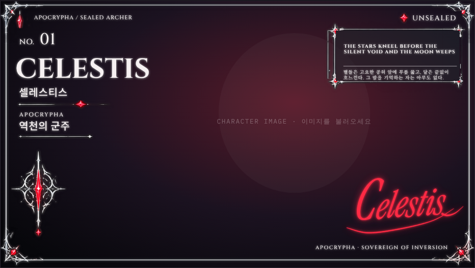
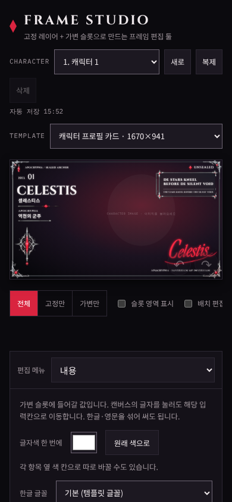

# Frame Studio 14 변경 내역

[평가 보고서](02-evaluation-report.md) 5-2 "다음" 단계 8건을 `Frame_Studio_13.html`에 적용해 `frame-studio/Frame_Studio_14.html`을 만들었습니다. v13에서 쓰던 데이터(입력값, 서명, 이미지)는 처음 열 때 첫 캐릭터로 자동으로 옮겨집니다.

## 바뀐 점

### 1. 캐릭터 목록
- 머리글에 캐릭터 선택과 **새로 / 복제 / 삭제** 버튼이 생겼습니다.
- 캐릭터마다 따로 기억하는 것: 입력값(템플릿별), 서명 설정, 캐릭터 이미지, 이미지 위치·확대(템플릿별)
- 모든 캐릭터가 함께 쓰는 것: 장식색, 글자색·크기·글꼴, 가독성, 테두리 막 같은 템플릿 꾸밈
- 목록에는 한글 이름(없으면 영문 이름)이 표시됩니다. 이름을 아직 견본 그대로 두었다면 "캐릭터 n"으로 나옵니다.
- 삭제는 두 번 눌러야 하고, 캐릭터가 하나뿐이면 지울 수 없습니다.
- 내보내기 탭에 **캐릭터 목록 전체 (→ ZIP)**가 생겼습니다. 캐릭터마다 자기 내용·서명·이미지·위치로 만듭니다.
- "글 하나로 내용 한 번에 채우기"에서 분석한 여러 명을 **캐릭터 목록에 추가**할 수 있습니다.
- 이미지는 캐릭터 id별로 IndexedDB에 저장합니다(v13은 `current` 한 칸).

### 2. 자동 줄바꿈
- 슬롯 속성에 `wrap`(자동 줄바꿈), `maxLines`(최대 줄 수), `grow`(줄이 늘어나는 방향: 아래로·위로)가 생겼습니다. 배치 탭에서 바꿀 수 있습니다.
- 띄어쓰기 단위로 최대 폭 안에 채우고, 한 덩어리가 폭보다 길면 글자 단위로 끊습니다. 최대 줄 수를 넘으면 5%씩 줄여 다시 맞춥니다.
- 25% 이내로만 줄이면 한 줄에 들어가는 글은 줄을 나누지 않습니다. 기본 견본 문구는 v13과 같은 모양입니다.
- 기본 카드 템플릿의 문구(quote)와 문구 번역(quoteSub)에 두 줄까지 켰습니다.

| 긴 문구 | v13 | v14 |
|---|---|---|
| 영문 57자 | 한 줄, 22px, 글자 간격 압축 | 두 줄, 17.6px, 압축 없음 |
| 한글 번역 51자 | 한 줄, 9.9px, 글자 간격 압축 | 두 줄, 16.2px, 압축 없음 |

### 3. 다시 그리기 가속
- 미리보기에서는 캐릭터 이미지를 SVG에 넣지 않고 그 아래 ``로 깔아, 위치·확대·회전·반전만 CSS로 맞춥니다. 미리보기 상자는 템플릿 비율을 따릅니다.
- 3000×2000 이미지가 있을 때 입력 한 번의 다시 그리기: **27ms → 5.8ms**
- 표식 이미지로 잰 미리보기와 내보낸 PNG의 이미지 위치 차이: 세 가지 위치·확대·회전 조합에서 모두 가로·세로 0.5% 이내
- 내보내기는 원래 방식 그대로입니다.

### 4. 일괄 생성 메모리
- 여러 이미지·CSV·캐릭터 전체 ZIP이 한 처리 함수를 씁니다.
- 모인 용량이 200MB(기기 메모리 4GB 이하는 80MB)를 넘으면 그때까지를 ZIP 하나로 저장하고 메모리를 비웁니다. 파일 이름은 `…_1_3장.zip`, `…_2_1장.zip`처럼 붙습니다.
- 진행 중에는 미리보기 아래에 **일괄 생성 중지** 버튼이 나옵니다. 누르면 그때까지 만든 것을 저장하고 멈춥니다.
- 예상 용량이 기준을 넘으면 진행 메시지에 미리 알려 줍니다.

### 5. 탭 정리
- WAI-ARIA 탭 패턴을 적용했습니다. Tab 키로 탭 줄에 한 번만 들어오고, ←/→/Home/End로 옮깁니다.
- "템플릿 JSON"과 "진행 단계"를 **고급** 탭 하나로 합쳤습니다. 진행 단계는 접힌 항목으로 들어갔습니다.

### 6. 저장 신뢰성
- 머리글에 "자동 저장 15:49" 같은 마지막 저장 시각이 나옵니다. 저장에 실패하면 "자동 저장 실패"로 바뀌고, 프로젝트 파일 저장을 권하는 안내를 한 번 띄웁니다.
- 처음 이미지를 불러오거나 캐릭터를 만들 때 브라우저에 영구 저장(`navigator.storage.persist()`)을 요청합니다.
- 고급 탭에 **이 템플릿 복제 / 이 템플릿 삭제**가 생겼습니다. 복제하면 꾸밈 설정도 함께 복사되고, 삭제는 직접 만든 템플릿만 두 번 눌러 지웁니다.

### 7. 모바일
- 도구 막대를 가로로 밀어 보는 한 줄로 바꿨습니다(높이 48px).
- 실행 취소·다시 실행 버튼을 화면 구석에서 미리보기 오른쪽 아래로 옮겨, 입력칸을 가리지 않습니다.

### 8. Safari 완화 (미검증)
- 내보내기에서 SVG 이미지의 decode를 기다린 뒤 한 번 버리는 그리기를 하고 나서 실제로 그립니다. Safari에서 SVG 속 프레임 이미지가 첫 그리기에 빠지는 문제에 알려진 완화책입니다.
- 보고서에서 제안한 "프레임 조각을 캔버스에 직접 그리기"는 확신도가 낮고(50%) Safari로 확인할 수 없어 이번에는 하지 않았습니다.

## 검증 (헤드리스 Chromium)

`tools/verify-frame-studio-14.js`, `tools/verify-art-alignment.js`, 그리고 v13 검증 스크립트를 v14에 다시 돌렸습니다.

- v13에서 이름과 이미지를 넣은 뒤 v14로 열기 → 첫 캐릭터 "LEGACY"로 이름·이미지가 옮겨짐
- 새로 → 견본 값, 이미지 없음, 한글 이름 칸에 커서. 캐릭터 2에 다른 이름·서명을 주고 1로 돌아가면 1의 이름·서명·이미지가 그대로
- 복제 → 이미지까지 복사. 삭제 → 두 번째 클릭에 삭제
- 새로고침 → 목록, 선택한 캐릭터, 캐릭터별 이미지 유지
- 캐릭터 전체 ZIP: 2명, 각자 이름으로 된 PNG 2장
- ZIP 분할: 3배 PNG(장당 28MB) 4장 → 3장과 1장, ZIP 2개. 중지: 4장 중 2장 저장
- ←·End 키로 탭 이동, 활성 탭만 tabIndex 0
- 템플릿 복제 후 삭제 → 목록 6개 → 5개, 기본 템플릿에서는 삭제 버튼 비활성
- v13 수정 10건 회귀 없음, 콘솔 오류 0건, 390px 화면 가로 넘침 없음

## 확인하지 못한 것
- iOS Safari, 실제 안드로이드 기기(8번 Safari 완화책의 효과 포함)
- Claude 아티팩트 안에서 저장 창이 있을 때 ZIP을 여러 개로 나눠 저장하는 흐름. 나뉜 ZIP마다 저장 확인 창이 한 번씩 뜹니다.
- 캐릭터가 아주 많을 때(수백 명)의 localStorage 용량. 캐릭터당 입력값은 수 KB이고 이미지는 IndexedDB에 따로 저장됩니다.
