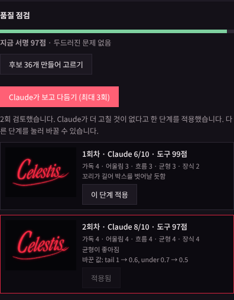
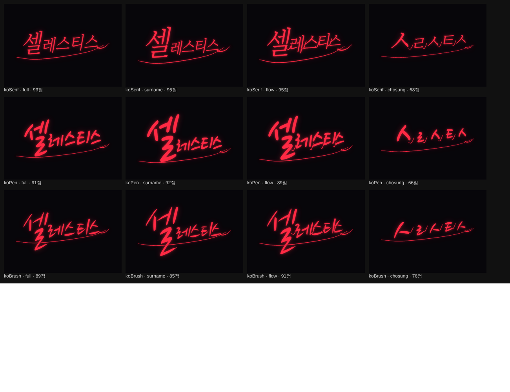

# Frame Studio 16 변경 내역 — 서명 AI 2단계

[서명 AI 방안](05-signature-ai.md)의 2단계 두 가지(C 보고 고치는 AI, F 한글 서명 개선)를 `Frame_Studio_15.html`에 적용해 `frame-studio/Frame_Studio_16.html`을 만들었습니다. v15에서 남겨 둔 "프로젝트 파일에 페르소나 넣기"도 함께 했습니다.

## 1. Claude가 보고 다듬기 (C)

서명 탭의 품질 점검 상자에 **Claude가 보고 다듬기 (최대 3회)** 버튼이 생겼습니다. Claude를 쓸 수 있을 때만 보입니다.

### 흐름
1. 지금 서명을 카드의 서명 자리와 같은 비율(520×365)의 어두운 배경 JPEG로 만듭니다.
2. 그림과 함께 다음을 Claude에게 보냅니다.
   - 캐릭터 정보(데이터로 감쌈), 페르소나, 취향 기록
   - 지금 파라미터, 도구가 잰 품질 점수와 문제
   - 이전 회차의 평가와 바꾼 값
3. Claude는 다섯 항목을 1~5점으로 매기고, 전체 1~10점, 더 고칠지 여부, 한두 문장 설명, 파라미터 수정안(1~4개)을 돌려줍니다.
   - 평가 항목: 가독, 캐릭터와의 어울림, 흐름, 균형, 장식
   - 수정안은 v15와 같은 범위 검사를 거칩니다. 색은 바꾸지 못하게 막았습니다.
4. 수정안으로 다시 그려 같은 과정을 되풀이합니다. Claude가 "다 됐다"고 하거나 고칠 것이 없으면 멈추고, 길어도 3회까지만 합니다.

### 결과 적용
- 회차마다 썸네일, Claude 점수, 도구 점수, 항목별 점수, 설명, 바꾼 값을 보여 줍니다. **이 단계 적용**으로 어느 회차든 고를 수 있습니다. 1회차는 처음 서명 그대로입니다.
- 끝나면 마지막 단계를 적용합니다. 다만 Claude가 보지 못한 마지막 수정안의 도구 점수가 8점 넘게 떨어졌으면, Claude가 가장 높게 본 회차를 적용합니다.

### 이미지를 보낼 수 없을 때
아티팩트 런타임의 `sample.limits()`에 `images`가 없는 화면에서는 그림 없이 측정값만 보냅니다. 프롬프트에 "그림은 볼 수 없다"고 밝히고, 결과 메시지에도 그 사실을 표시합니다.

### 주의
- 회차마다 Claude를 한 번 부릅니다(default 등급, 캐시 없음). 사용자의 Claude 사용량이 쓰이고, 회차마다 10~40초 걸릴 수 있습니다. **중지** 버튼으로 멈출 수 있습니다.

## 2. 한글 서명 개선 (F)

### 한글 손글씨 서명체 2종
- **한글 펜글씨**와 **한글 붓글씨**를 내장했습니다.
- 나눔손글씨 펜·붓(© 2010 NHN Corporation, SIL OFL 1.1)에서 KS X 1001 완성형 2,350자, 호환 자모, 기본 ASCII만 남긴 WOFF입니다. 펜 560KB, 붓 620KB입니다.
- OFL의 예약 글꼴 이름(Nanum 계열) 조항에 따라 수정본의 글꼴 이름을 `FS Hand Pen KR`, `FS Hand Brush KR`로 바꿨습니다.
- 글꼴 안에 저작권·라이선스 정보를 넣었고, 저장소에 라이선스 전문(`frame-studio/fonts/OFL-NanumHand.txt`)과 서브셋 스크립트(`tools/subset-korean-font.py`)를 넣었습니다. 서명 탭의 글꼴 안내문에도 출처를 적었습니다.
- 이 때문에 HTML 파일이 2.4MB에서 3.8MB로 커졌습니다.

### 한글 서명 방식 (서명 원문 옆 선택 칸)

| 방식 | 하는 일 |
|---|---|
| 그대로 | v15와 같음 |
| 성 강조 | 첫 음절을 키우고(×1.15) 나머지를 줄이며(×0.8) 간격을 좁힘 |
| 흘려 쓰기 | 뒤 음절로 갈수록 작고(최소 ×0.7) 높아지며, 음절 사이를 잇는 획을 그림 |
| 초성만 | 각 음절을 초성 자모로 바꿔 씀(셀레스티스 → ㅅㄹㅅㅌㅅ). 자모의 실제 높이를 재서 음절 크기에 맞추고 실제 폭만큼만 띄우며, 흘려 쓰기처럼 이음 |

- 잇는 획은 글자 획으로 셈하므로 "스와시가 글자를 덮음" 경고가 나오지 않습니다.
- 한글은 받침 유무로 글자 바닥이 원래 다르므로, 기준선 흔들림을 글자 가운데 높이로 재도록 바꿨습니다. 바꾸기 전에는 노토 명조 "셀레스티스"가 79점에 "기준선이 들쭉날쭉함"으로 나왔고, 바꾼 뒤 93점입니다.
- 페르소나가 한글 서명체와 방식도 고릅니다.
  - 서명체: 역동·장식이 높으면 붓글씨, 흘려 씀이 높거나 자유로우면 펜글씨, 날카롭고 현대적이면 노토 고딕, 그 밖에는 노토 명조
  - 방식: 흘려 씀이 아주 높고 자유로우면 초성만, 흘려 씀이 높으면 흘려 쓰기, 격식·고전이 높으면 성 강조
- Claude의 "말로 조정"·"AI 제안"·"보고 다듬기"도 이 방식을 바꿀 수 있습니다.

| 셀레스티스, 도구 점수 | 그대로 | 성 강조 | 흘려 쓰기 | 초성만 |
|---|---|---|---|---|
| 노토 명조 | 93 | 95 | 95 | 68 |
| 한글 펜글씨 | 91 | 92 | 89 | 66 |
| 한글 붓글씨 | 89 | 85 | 91 | 76 |

초성만은 글자 수가 적고 자모가 단순해 점수가 낮게 나옵니다. 알아보기 어려운 것이 원래 특징인 방식이라, 점수보다 의도를 보고 고르는 것이 맞습니다.

## 3. 그 밖에
- 프로젝트 저장 파일에 페르소나가 들어가고, 불러오면 되살아납니다.
- 진행 단계에 P8 항목을 추가했습니다.

## 검증 (헤드리스 Chromium)

`tools/verify-frame-studio-16.js`로 확인했습니다. `window.claude`를 정해진 응답을 돌려주는 가짜로 바꿔 끼워 흐름만 확인했습니다.

- **이미지를 보낼 수 있는 화면**
  - 1회차: JPEG 1장(약 20KB)을 보내고 6/10 → tail 1 → 0.6, under 0.7 → 0.5 적용. 응답에 섞인 색 변경과 없는 파라미터는 무시됨
  - 2회차: 이전 회차 내용을 넣어 보냄 → 8/10, 다 됐다고 함 → 2회차 적용
  - "1회차 적용"으로 처음 서명(tail 1)으로 돌아감
- **보낼 수 없는 화면:** 같은 흐름. 프롬프트에 "그림은 볼 수 없다"가 들어가고, 결과 메시지에 측정값만 보냈다고 표시됨
- **한글:** 흘려 쓰기 95점. 페르소나(역동 0.8, 장식 0.8)가 한글 붓글씨·흘려 쓰기를 고름. 서명체 목록에 새 글꼴 2종 표시
- **프로젝트 파일:** 저장하면 페르소나와 koMode가 들어가고, 페르소나를 끈 뒤 불러오면 "Claude 추정" 페르소나가 되살아남
- **회귀:** v13·v14·v15 검증을 v16에 다시 돌려 모두 통과, 콘솔 오류 0건

## 확인하지 못한 것
- 실제 Claude가 서명 그림을 보고 내리는 평가와 수정의 품질. 방안 문서에서 짚은 대로, 다중모달 모델의 디자인 비평은 약하다는 연구가 있습니다. 도구 점수와 함께 보고, 회차를 직접 고를 수 있게 만든 이유입니다.
- Claude 아티팩트 화면에서 `sample.limits()`가 실제로 `images`를 알려 주는지.
- 흘려 쓰기·초성만의 잇는 획은 정해진 곡선이라, 손으로 이어 쓴 것만큼 자연스럽지 않습니다. 장식적인 선택지에 가깝고, 자연스러운 연결은 3단계(E, 펜 획 엔진)에서 다룰 부분입니다.
- 한글 손글씨 글꼴 2종이 들어가 파일이 커졌습니다(3.8MB). 휴대폰에서 처음 여는 시간이 늘 수 있습니다.
