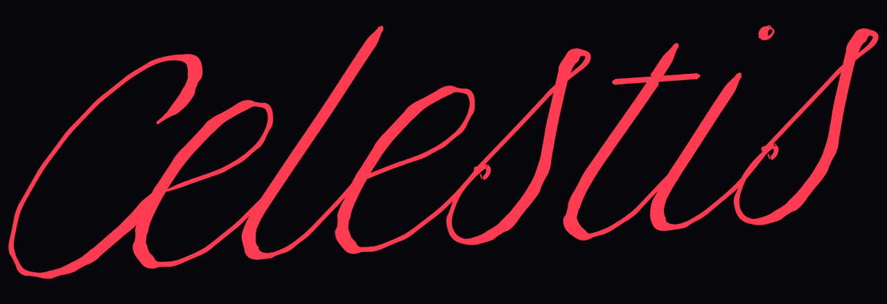
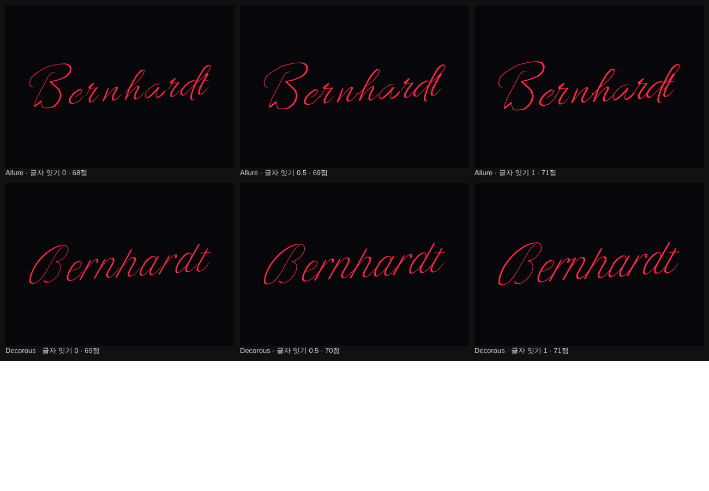
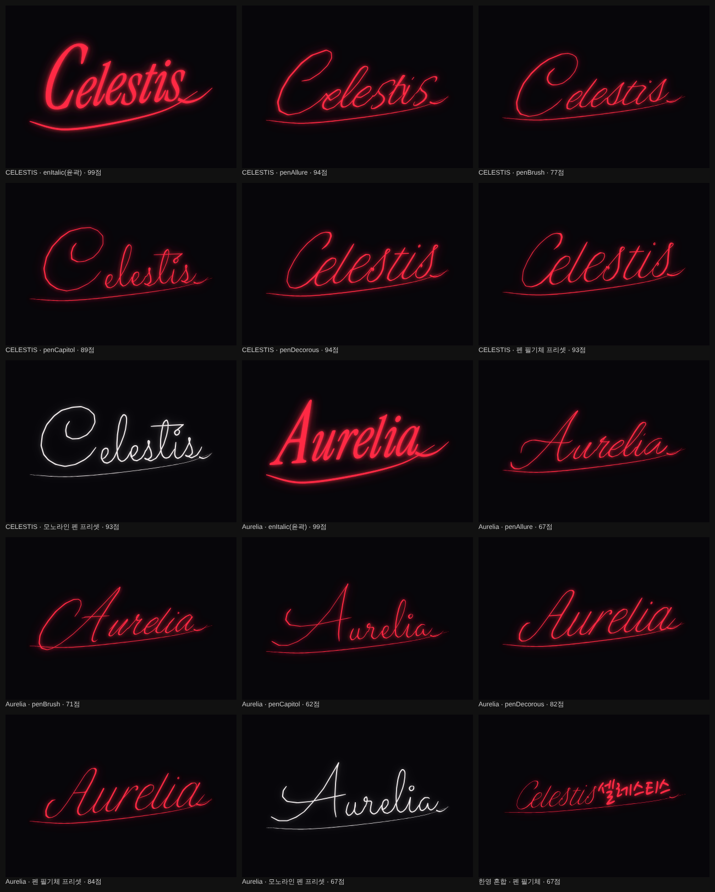

# Frame Studio 17 변경 내역 — 서명 3단계: 펜 획 엔진

[서명 AI 방안](05-signature-ai.md)의 3단계(E)를 `Frame_Studio_16.html`에 적용해 `frame-studio/Frame_Studio_17.html`을 만들었습니다. v16까지의 서명은 글꼴 윤곽(획의 양쪽 가장자리)을 비틀어 만들었습니다. 그래서 펜으로 쓴 느낌, 즉 필압·속도에 따른 굵기 변화와 글자 사이를 잇는 흐름이 없었습니다. v17은 영문에 한해 **펜이 지나간 선(중심선)**에서 출발해 굵기를 직접 입힙니다.

## 1. 펜 서명체 4종

영문 서명체 목록에 **펜 · Allure / 펜 · Brush / 펜 · Capitol (모노라인) / 펜 · Decorous**가 생겼습니다. 이 중 하나를 고르면 영문 글자는 펜 획 엔진으로 그리고, 한글은 지금처럼 윤곽 엔진(노토·펜글씨·붓글씨)으로 그립니다.

| 서명체 | 원본(Google Fonts, OFL) | 특징 |
|---|---|---|
| 펜 · Allure | Allura | 우아한 이음 필기체 |
| 펜 · Brush | Alex Brush | 활기찬 붓펜 필기체 |
| 펜 · Capitol | Sacramento | 가는 모노라인 필기체 |
| 펜 · Decorous | Petit Formal Script | 격식 있는 뾰족펜 필기체 |

- 데이터는 Evil Mad Scientist의 [svg-fonts](https://gitlab.com/oskay/svg-fonts) 모음에 있는 EMS 한 줄 글꼴(Sheldon B. Michaels 작, Windell H. Oskay 변환, SIL OFL 1.1)입니다. 여기서 ASCII 95자의 선만 좌표 배열로 옮겼고, 4종을 합쳐 약 70KB입니다.
- 라이선스 정보와 OFL 전문은 `frame-studio/fonts/OFL-EMS-stroke.txt`, 변환 스크립트는 `tools/convert-stroke-fonts.py`에 있습니다.
- 처음 골랐던 Hershey 필기체(1967년 공개, 출처 표기 조건)는 비교 결과 모양이 투박해 넣지 않았습니다.

## 2. 그리는 과정

1. **배치.** 글자마다 중심선을 놓습니다. 첫 글자 확대·흔들림·자간은 윤곽 엔진과 같습니다.
2. **잇기.** 앞 글자의 마지막 획 끝과 다음 글자의 가장 가까운 시작점이 가까우면 한 획으로 붙입니다. 띄어쓰기와 한글을 만나면 끊습니다.
3. **변형.** 기울기·오르막·세로 늘임·가로 폭을 중심선에 먼저 적용합니다. 그래야 굵기가 비틀리지 않습니다.
4. **다듬기.** 급하게 꺾이는 곳(105° 넘게)에서 획을 나누고, 꼭짓점을 Chaikin 방식으로 곡선화(각진 정도 0이면 4회, 1이면 0회)한 뒤, 3단위 간격으로 다시 찍습니다. 흔들림 값에 비례해 천천히 변하는 손떨림을 더합니다.
5. **굵기.** 점마다 세 요소를 곱합니다.
   - 필압: 시작 22단위, 끝 38단위에 걸쳐 가늘어짐
   - 속도: 굽은 곳이 굵어짐
   - 뾰족펜 대비: 화면 아래로 내려긋는 획은 굵게, 올려긋는 획은 가늘게
   - 곡선 안쪽이 접히지 않게 곡률 반지름으로 상한을 둡니다. 앞뒤 7점으로 고르게 펴서 마디가 생기지 않게 합니다.
6. **리본.** 둥근 끝을 가진 다각형으로 만들고, 거의 일직선인 점은 덜어 냅니다.

## 3. 새 조절과 프리셋

세부 조절에 세 가지가 생겼습니다. 펜 서명체에만 적용됩니다.

| 조절 | 범위 | 기본 | 하는 일 |
|---|---|---|---|
| 필압 변화 | 0~1 | 0.7 | 획 시작·끝의 가늘어짐과 굽은 곳의 굵어짐 |
| 획 대비 | 0~1 | 0.6 | 내려긋는 획과 올려긋는 획의 굵기 차이 |
| 글자 잇기 | 0~1 | 0.85 | 1이면 글꼴이 설계한 대로 이어 쓰고, 낮을수록 글자 사이를 벌려 펜을 뗀 자리가 보임(0.3 이하는 잇지 않음) |

- 획 굵기는 펜의 기본 굵기가 됩니다(x높이 100 기준 5~23단위). 각진 정도는 곡선 다듬기 횟수를 줄여 각지게 만듭니다.
- 프리셋 **펜 필기체**(Decorous, 붉은색)와 **모노라인 펜**(Capitol, 흰색)을 추가했습니다.
- 페르소나가 고르는 영문 서명체를 바꿨습니다.
  - 날카로움이 높을 때만 기존 각진 윤곽 서명체를 씁니다.
  - 그 밖에는 펜 서명체를 고릅니다: 고전·격식이 높으면 Decorous, 역동적이고 자유로우면 Brush, 절제·현대적이면 Capitol, 나머지는 Allure.
  - 필압·대비·잇기도 축에서 계산합니다.
- 후보 만들기는 필압·대비도 조금씩 바꿔 봅니다. Claude의 말로 조정·AI 제안·보고 다듬기도 새 조절을 바꿀 수 있습니다.

## 4. 품질 점검 보정

- **기준선 흔들림을 엔진이 아는 실제 기준선으로 잽니다.** 엔진은 글자마다 놓은 기준선 위치(흔들림 포함)를 알고 있으므로, 이제 글자 바닥 대신 그 값을 씁니다.
  - 펜 서명체는 필기체의 들어오는 획 때문에 "기준선이 들쭉날쭉함"으로 부당하게 감점되고 있었습니다. 고친 뒤 Allure Celestis는 75 → 94점, Capitol은 75 → 89점이 되었습니다.
  - 윤곽 엔진의 점수 분포는 거의 그대로입니다(보통 서명 중앙값 88 → 86. 측정 대상에 펜 프리셋 2종이 늘어난 영향 포함). g·p 같은 내림 획이나 한글 받침에도 더는 속지 않습니다.
- 펜 글자의 세로 범위는 점 분포의 10~90% 지점으로 잽니다.

| Celestis, 도구 점수 | 점수 |
|---|---|
| 윤곽 Instrument Serif Italic | 99 |
| 펜 · Allure | 94 |
| 펜 · Brush | 77 |
| 펜 · Capitol | 89 |
| 펜 · Decorous | 94 |

펜 서명체는 윤곽보다 획이 가늘어 점수가 조금 낮게 나옵니다. 점수는 크기·밀도·흔들림을 재는 것이라 "손으로 쓴 느낌"은 반영하지 못합니다.

## 5. 성능

| 항목 | 윤곽 엔진 | 펜 획 엔진 |
|---|---|---|
| 서명 하나 그리기 | 0.3~1.2ms | 1.3~6ms (27자 이름 4~7ms) |
| 서명 경로 크기 | 28~29KB | 35~41KB (27자 이름 약 100KB) |
| 입력 한 번 다시 그리기(카드 전체) | 약 6ms | 약 14ms |
| 후보 36개 | 약 80ms | 약 130ms |

처음 붙였을 때는 곡선 다듬기가 점을 16배로 늘려 경로가 330~380KB였습니다. 일정 간격 재표본과 다각형 단순화로 약 10분의 1로 줄였습니다.

## 6. 한계
- **한글은 아직 윤곽 엔진입니다.** 한글 한 줄 글꼴은 찾지 못했습니다. 2,350자를 손으로 중심선을 따는 것은 이번 범위를 넘습니다.
- **한영 혼합 서명의 영문 펜 획과 한글 윤곽 글자는 굵기 체계가 다릅니다.** 펜 서명체를 쓰면 SVG 외곽선 두께를 줄이므로, 혼합 서명의 한글이 조금 가늘어집니다.
- **잇는 방식은 글꼴이 설계한 연결에 기댑니다.** 앞뒤 글자를 잇는 새 곡선을 만들지는 않습니다. 대문자처럼 원래 떨어진 글자는 떨어진 채로 둡니다.
- **글자 모양은 4종 글꼴의 모양을 따릅니다.** 같은 글자는 같은 골격이고, 흔들림·손떨림·변형 번호로만 달라집니다. 사람 필체처럼 글자 골격 자체가 달라지게 하려면 방안 문서 G의 생성 모델이 필요합니다.

## 검증 (헤드리스 Chromium)

`tools/verify-frame-studio-17.js`, `tools/compare-pen-fonts.js`로 확인했습니다.
- 서명체 목록에 펜 4종 표시, 새 조절 3개 생성
- "펜 필기체" 프리셋 93점, 글자 잇기 0과 1에서 경로가 달라짐
- 입력 한 번 다시 그리기 중앙값 13.5ms, 후보 36개 137ms
- 보고 다듬기: 흉내 낸 Claude가 필압·대비를 바꾸고 프롬프트에 새 조절과 펜 서명체가 들어감
- 페르소나(역동 0.8, 격식 0.3)가 펜 · Brush를 고름
- PNG 내보내기 정상
- 회귀: v13·v14·v15·v16 검증을 v17에 다시 돌려 모두 통과, 콘솔 오류 0건. v15 검증은 한 번 실패했는데, 무작위 후보의 꼬리 길이가 최대값 근처여서 두 번째 조정이 기록 기준보다 작았던 탓입니다. 다시 두 번 돌려 모두 통과했습니다(도구 결함 아님).

## 확인하지 못한 것
- 실제 사람이 보기에 펜 서명이 윤곽 서명보다 나은지. 방안 문서 4절의 블라인드 비교를 권합니다.
- iOS Safari·실제 휴대폰에서 펜 서명의 그리기 속도
