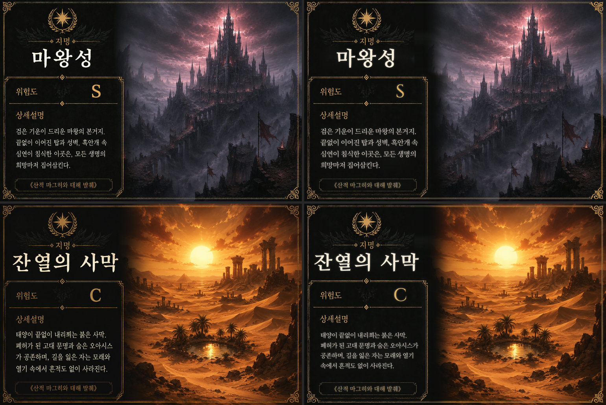
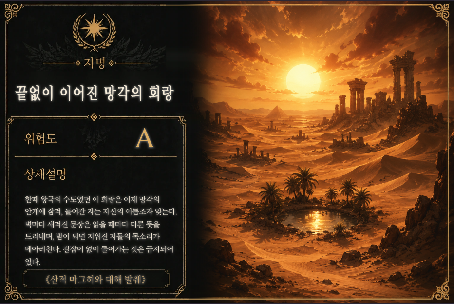
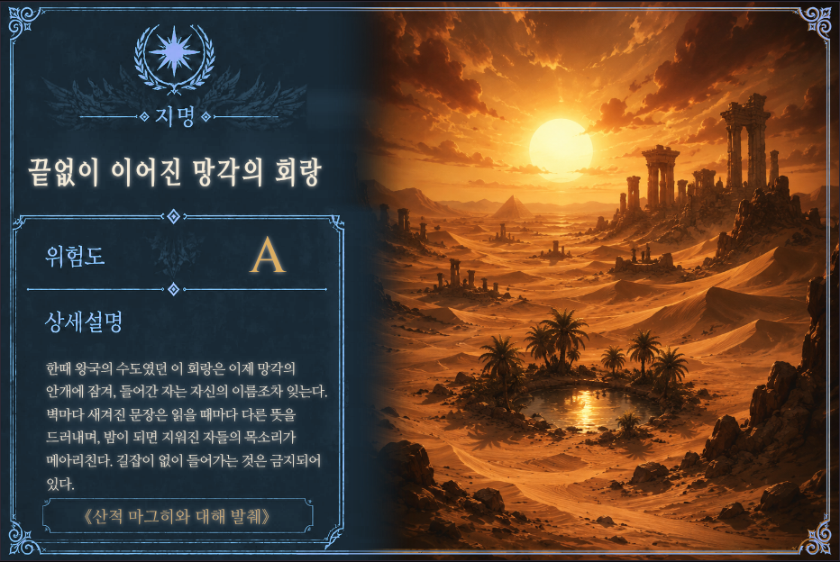

# Frame Studio 18 — 지명 카드 템플릿

사용자가 준 지명 카드 두 장(마왕성, 잔열의 사막)에서 프레임을 추출해 새 템플릿 **지명 카드**(`region-card`, 1534×1024)를 만들었습니다. `frame-studio/Frame_Studio_18.html`의 템플릿 목록에서 고를 수 있습니다.

## 고정 요소와 가변 요소

| 구분 | 요소 | 구현 |
|---|---|---|
| 고정 | "지명", "위험도", "상세설명" 글자 | 원본에서 추출한 왼쪽 패널 이미지에 포함 |
| 고정 | 문장(별·월계관), 날개 문양, 바깥 프레임, 안쪽 상자, 구분선, 발췌 상자 테두리 | 왼쪽 패널 이미지 + 오른쪽 모서리·테두리 선 조각 |
| 가변 | 지역 이름 | 텍스트 칸 `region` — 나눔명조 800, 가운데 정렬, 최대 폭 540(길면 줄어듦) |
| 가변 | 위험도 등급 | 텍스트 칸 `grade` — Cinzel, 금색, 가운데 정렬 |
| 가변 | 하단 발췌 칸 | 텍스트 칸 `source` — 나눔명조, 금색, 가운데 정렬, 최대 폭 440 |
| 가변 | 상세설명 본문 | 텍스트 칸 `desc` — 나눔명조 35px, 자동 줄바꿈 |
| 가변 | 오른쪽 그림 | 캐릭터 이미지 칸(이미지 탭) |

요청하신 가변 목록에는 상세설명 본문이 없었습니다. 하지만 두 카드에서 본문이 서로 달라 가변 칸으로 넣었습니다. 고정으로 바꾸려면 고급 탭의 템플릿 JSON에서 `desc` 칸을 지우면 됩니다.

## 추출 방법

두 카드는 같은 프레임을 따로 생성한 그림이라, 장식이 1~2px씩 어긋나고 세부도 조금 다릅니다. 그래서 두 장의 차이로 고정 요소를 가를 수 없었습니다. 장식이 더 선명한 **마왕성 카드 한 장**에서 추출했고, 스크립트는 `tools/extract-region-template.py`입니다.

1. **왼쪽 패널** (`rgnPanel`, 790×1024, WebP 50KB)
   - 원본의 왼쪽을 잘라 냅니다.
   - 가변 글자 네 곳을 사각형째 지웁니다. 글자의 어두운 그림자 테두리까지 지워야 자국이 남지 않습니다.
   - 지운 자리는 두 겹으로 메웁니다. 바탕은 밝은 장식이 번져 들지 않게 눌러 흐린 배경이고, 그 위에 글자 없는 영역에서 떼어 온 배경 결을 입힙니다.
   - 오른쪽 끝은 그림으로 자연스럽게 사라지도록 투명도를 줍니다. 안쪽 상자 위쪽은 x 600부터, 상자 옆은 상자 테두리 뒤 x 644부터입니다.
   - 원본에서 패널 경계에 비쳐 있던 성 그림(보랏빛·붉은빛)은 배경색으로 바꿔, 다른 그림을 넣어도 남지 않게 했습니다.
2. **오른쪽 모서리** (`rgnTR`, `rgnBR`)
   - 오른쪽 장식은 그림 위에 얹혀 있어 깨끗하게 떼기 어렵습니다. 그래서 검은 배경 위의 왼쪽 모서리를 떼어 좌우로 뒤집었습니다.
   - 금색은 밝기로 투명도를 정하고, 배경을 빼서 색을 되살려 분리했습니다.
   - 원본의 오른쪽 선 위치(x 1511·1515)가 왼쪽 선(x 17·21)을 정확히 뒤집은 자리라 위치가 맞습니다.
3. **테두리 선** (`rgnEdgeT/B/R`)
   - 위·아래·왼쪽 이중선을 여러 열·행의 중앙값으로 고른 8px 조각으로 만들었습니다. 템플릿에서는 `slice9`(여백 0)로 늘려 붙입니다.

추출한 에셋과 칸 설정은 `frame-studio/templates/region-card/`에 있습니다.

## 위치 맞추기

원본 그림을 캐릭터 이미지로 넣고 같은 글을 채워 내보낸 뒤, 밝은 픽셀의 줄 범위를 원본과 비교하며 맞췄습니다(`tools/render-region-card.js`).

| 칸 | 원본 | 새 템플릿 |
|---|---|---|
| 지역 이름 "마왕성" | y 247~344 | y 247~344 |
| 위험도 "S" | y 430~495 | y 429~495 |
| 본문 첫 줄 | y 652~684 | y 652~684 |
| 발췌 | y 926~955, x 154~489 | y 928~955, x 154~489 |

- 마왕성 본문은 원본과 줄바꿈 위치까지 같습니다.
- 잔열의 사막 본문은 원본 글꼴보다 나눔명조가 넓어(같은 문장 547px 대 489px) 4줄에 약 32px로 조금 작게 들어갑니다. 원본 본문 글꼴은 폭이 좁은 서체라 페이지에 있는 한글 명조 5종 모두 원본보다 넓었습니다. 그래서 모양이 가장 비슷한 나눔명조에 자간 -0.04를 주었습니다.

## 함께 바뀐 공통 기능

- **템플릿 글꼴 `myeongjo`(나눔명조) 추가.** 배치 탭의 글꼴 목록에도 들어갔고, SVG로 내보낼 때 웹글꼴 목록에 포함됩니다.
- **줄바꿈 칸 옵션 두 가지 추가.**
  - `maxH`: 높이 한도. 글자가 작아질수록 들어가는 줄 수를 늘립니다. 긴 본문(150자)이 4줄 18.9px 대신 6줄 25.7px로 들어갑니다.
  - `shrinkFirst: false`: 조금 줄여 한 줄에 맞추기보다 먼저 줄을 나눕니다(본문용).
- **내보내기 전에 줄바꿈 칸 글자의 웹글꼴 조각을 먼저 불러옵니다.** 한글 웹글꼴은 글자 묶음별로 늦게 받아지므로, 덜 받은 상태로 재면 실행마다 줄바꿈이 달라졌습니다. 고친 뒤 두 번 내보내 같은 결과를 확인했습니다.
- **캐릭터 목록 이름에 지역 이름 사용.** 지역 이름을 바꾸면 목록에 그 이름이 표시됩니다.

## 그 밖의 기능과 함께 쓰기

- **장식색:** 패널·모서리·테두리 선이 함께 물듭니다(아래 "빙결"). 짙은 배경도 그 색을 조금 띠고, 가변 글자는 내용 탭의 글자색으로 따로 바꿉니다.
- **배치 편집:** 네 칸 모두 끌어 옮기거나 크기를 바꿀 수 있습니다.
- **나머지:** 일괄 생성(CSV·여러 이미지·캐릭터 목록), 프리셋, 테두리 막, 실행 취소가 다른 템플릿과 똑같이 동작합니다.
- **서명:** 이 템플릿에는 서명 칸이 없습니다.

## 검증 (헤드리스 Chromium)

- 템플릿이 목록에 나오고, 템플릿 JSON 검증을 통과합니다.
- 입력칸 4개(지역 이름·위험도 등급·상세설명·발췌 출처)가 나옵니다.
- 긴 지역 이름(13자)은 56px로 줄어 폭 540에 들어가고, 긴 본문은 6줄로 상자 안에 들어갑니다.
- SVG 내보내기에 나눔명조 @import와 WebP 패널이 들어갑니다(2.8MB). PNG 내보내기도 정상입니다.
- 회귀: v13·v14·v15·v16·v17 검증을 v18에 다시 돌려 모두 통과, 콘솔 오류 0건

## 한계

- 패널은 마왕성 카드 한 장에서 추출했으므로, 문장·날개 문양의 세부는 그 카드 모양을 따릅니다.
- 위험도 등급과 발췌 칸은 한 줄입니다. 긴 발췌는 줄어들어 맞춰집니다.
- 패널의 지운 자리(지역 이름 등)는 배경 결을 복제해 메웠습니다. 원본과 겹쳐 확대하면 결의 반복이 보일 수 있습니다.
